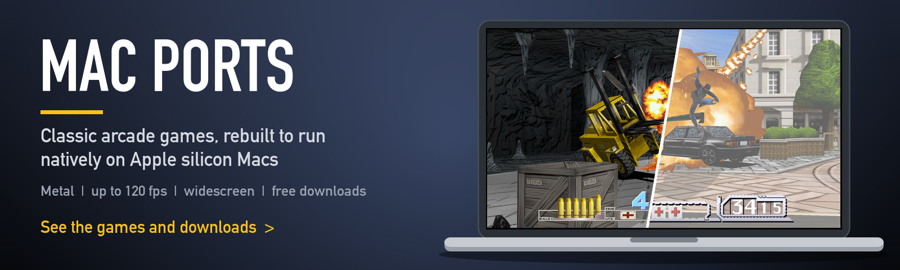
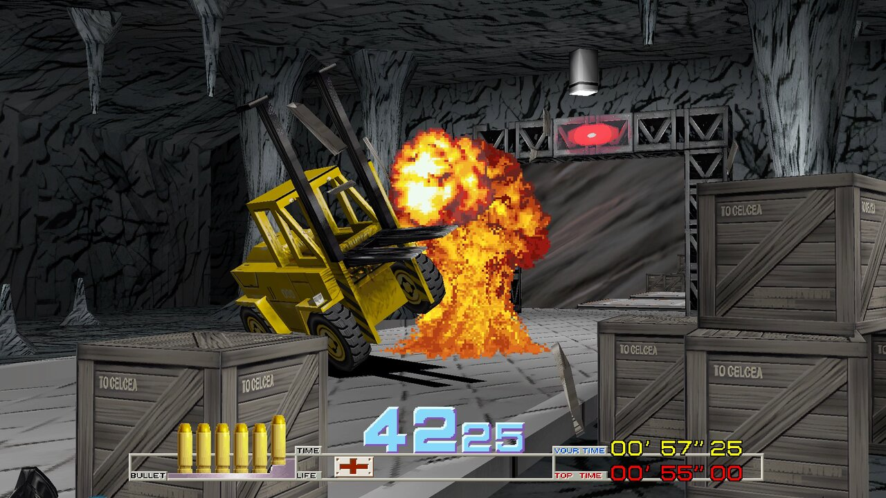
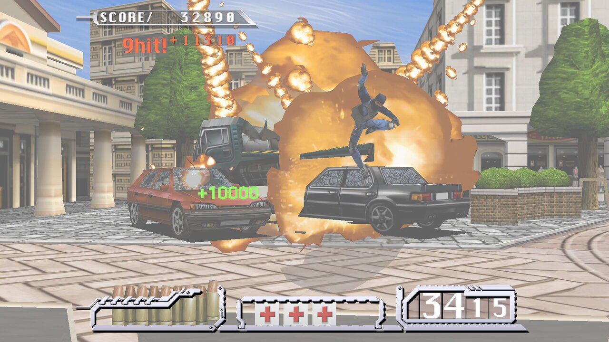

Classic arcade games, rebuilt as native apps for Macs with Apple silicon. Nothing is emulated: each game's original code is translated into a Mac program and drawn with Metal, at up to 120 frames per second, in widescreen, with mouse controls.

Every download is free. The apps don't include the games themselves: you bring your own copy of each arcade game, and the app asks for it the first time it opens.

## The games

| | Game | Original | Status | Download | Details |
|---|---|---|---|---|---|
|  | **Time Crisis** | Namco arcade, 1995 | ✅ Playable | [⬇️ Download (9.8 MB)](https://github.com/gkaragioul/namco22-decompile/releases/download/mac-1.0/Time-Crisis-for-Mac-1.0.dmg) | [Game page](games/time-crisis.md) |
|  | **Time Crisis II** | Namco arcade, 1997 | ✅ Playable | [⬇️ Download (10.3 MB)](https://github.com/gkaragioul/namco22-decompile/releases/download/mac-1.0/Time-Crisis-II-for-Mac-1.0.dmg) | [Game page](games/time-crisis-2.md) |

More games will be added to this list as their ports are finished.

## What you need

- A Mac with Apple silicon (M1 or newer)
- macOS 13 Ventura or newer
- Your own copy of the game, as its MAME ROM set (each game page says which file)

Each game page has the install steps, the controls and help if something goes wrong.

## Credits

These ports build on the work of open-source projects that translated the original arcade code. Each game page credits its project. Each Mac port is also offered back to its project.

*Time Crisis is a trademark of Bandai Namco Entertainment. This is an unofficial fan project, not affiliated with or endorsed by any game publisher. No game data is included or distributed here.*
