[← All games](../README.md)

# Thief Gold for Mac

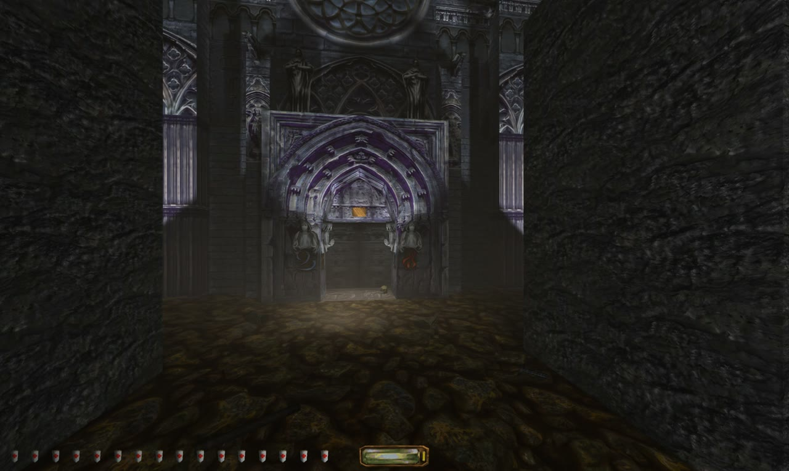

**The 1999 stealth classic by Looking Glass Studios, rebuilt as a native Mac game.** It runs on Apple silicon with nothing emulated and nothing translated. Every frame is drawn with Metal at up to 120 frames per second, with modern lighting, AI-remastered cutscenes and console-simple settings.

> 🔬 **Research port:** a complete native Mac version, shown here in action. [Rights holders: let's talk.](#for-publishers-and-rights-holders)

## At a glance

| | |
|---|---|
| **Platform** | Macs with Apple silicon, native arm64, Metal |
| **Frame rate** | Up to 120 fps, with variable refresh on ProMotion screens |
| **Campaign** | All 17 missions, with their mission scripts rewritten as native code |
| **Cutscenes** | All 24, AI-remastered from 320×240 to 1280×960 |
| **Settings** | Three choices, like a console: Performance, Quality, Battery |
| **Extras** | In-game browser for 257 community fan missions, each one tested |
| **Status** | 🔬 Research: playable, not released |

## Watch it

[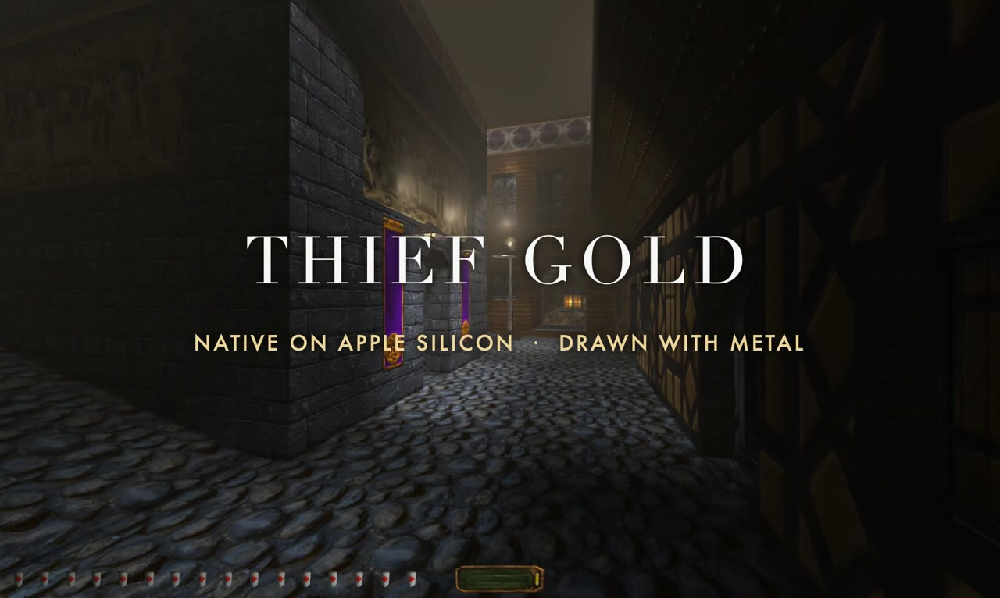](https://gkaragioul.github.io/mac-ports/videos/thief-gold.mp4)

35 seconds of real gameplay recorded on a Mac, on the Quality setting: sword fights with Bafford's guards, broadhead arrows, a zombie attack, a fire elemental lighting up the fog, the haunted cathedral and the city at night. The video has no sound.

## In action

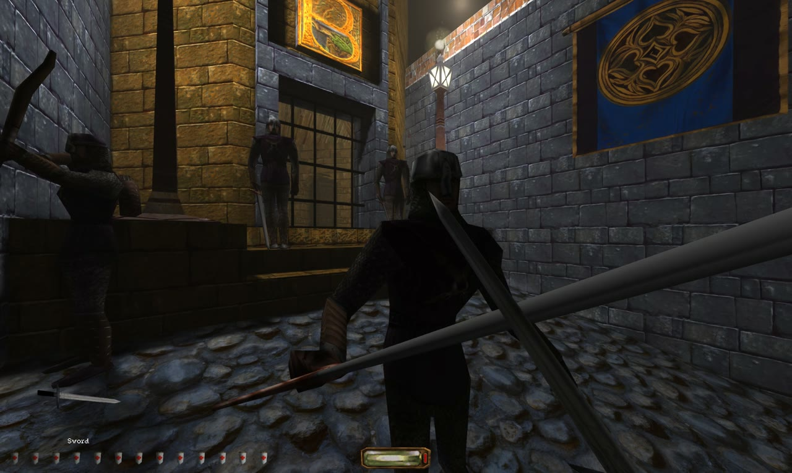 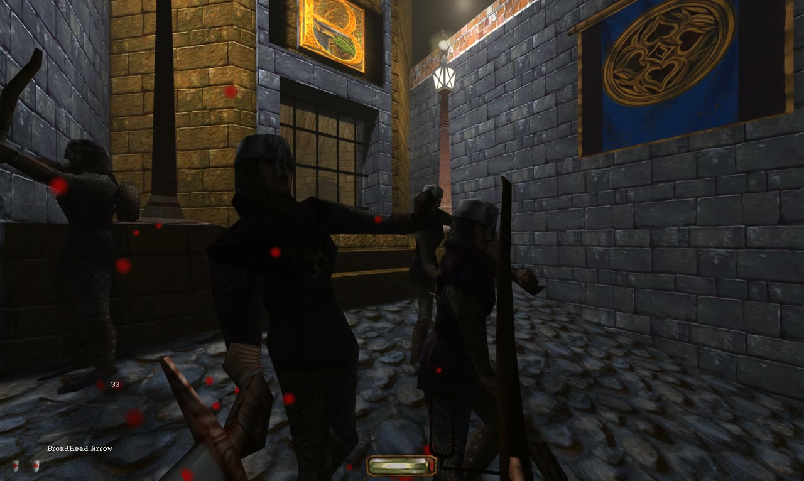

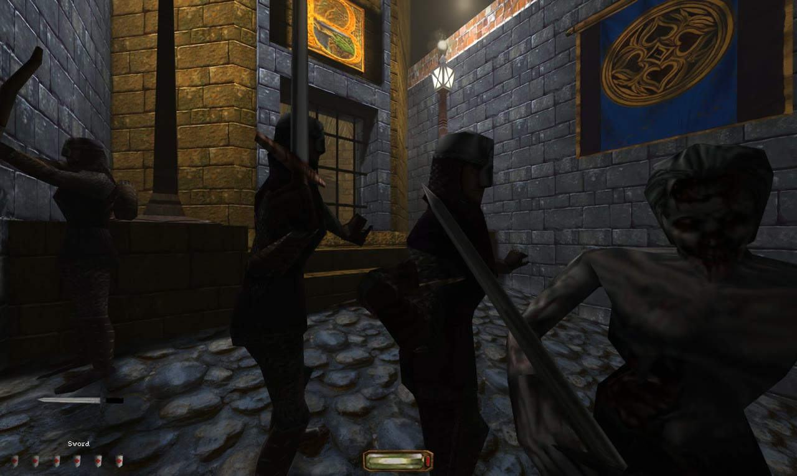 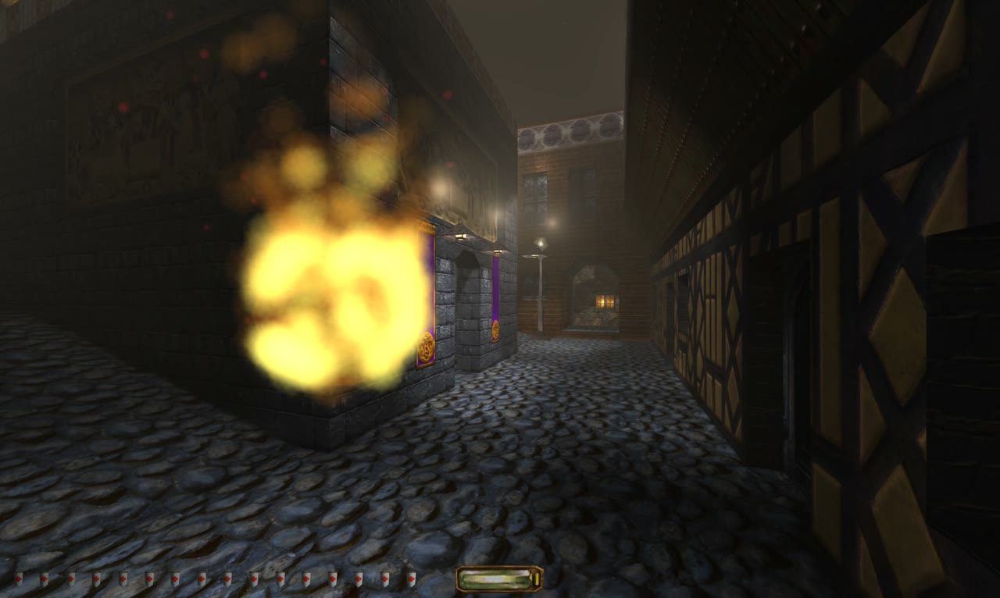

*Sword against Bafford's guards · a broadhead arrow finds its mark · a zombie joins the fight · a fire elemental lights up the fog*

## Then and now

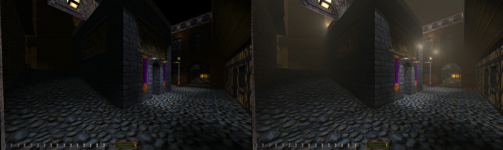

The same view, rendered twice. On the left, the classic look: no effects, no anti-aliasing. On the right, the Mac's Quality setting: lamp-lit fog, glow around every light, smooth edges and sharp textures.

## What's new on the Mac

**Made for Apple silicon**
- Native arm64 app, drawn with Metal. No emulation, no Wine, no translation.
- The game's mission scripts were Windows code. Each one has been rewritten as native code, all 255 of them.
- Opens in full screen, fills any screen sharply at full Retina resolution, with Game Mode support

**Smooth and simple**
- Up to 120 frames per second. On MacBook Pro screens, variable refresh shows every frame as soon as it's ready, so small dips stay smooth.
- One Graphics choice instead of a wall of switches. **Performance** (120 fps), **Quality** (60 fps, best looks) or **Battery** (60 fps, saves power), and nothing changes behind your back.

**A remastered look**
- Apple MetalFX anti-aliasing and upscaling
- Fog and light shafts around lamps, glow around bright lights
- Dynamic shadows from characters and doors. Guards notice Garrett's shadow, too.
- HDR highlights on XDR screens, and ray-traced shadows in Quality
- Widescreen with a field-of-view setting, and a HUD that scales for large screens
- All 24 cutscenes remastered with AI upscaling, plus subtitles

**Sound and controls**
- Room echo through the Mac's own audio, 3D sound for headphones and AirPods head tracking
- A modern WASD layout and raw mouse look
- PlayStation DualSense support with rumble, gyro aiming and trigger resistance on the bow

**More to play**
- An in-game browser for community fan missions. All 257 in its catalogue have been tested.
- Save pages with pictures, and autosave
- Works with community HD texture packs and high-detail character models

## Gallery

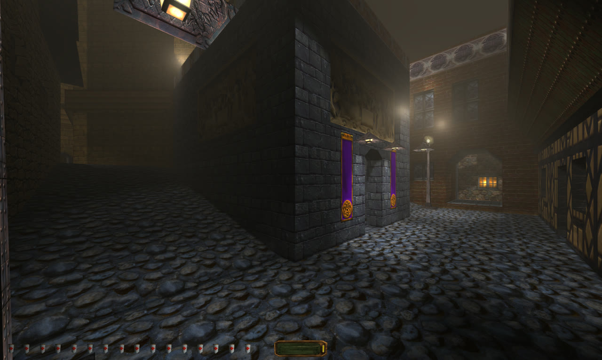

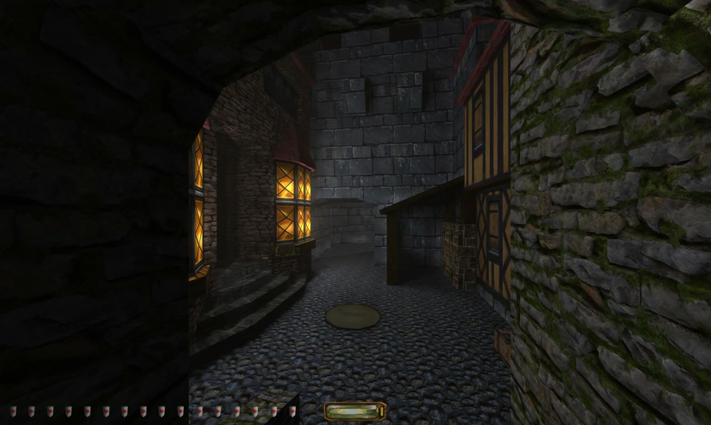 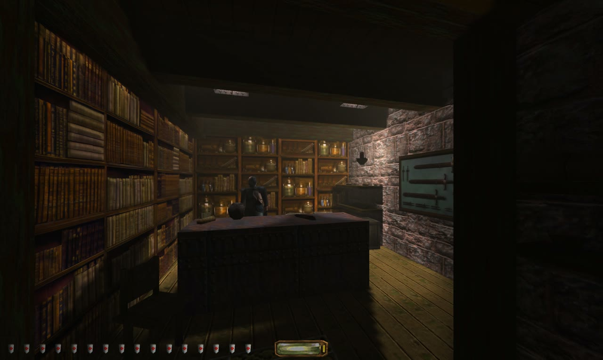

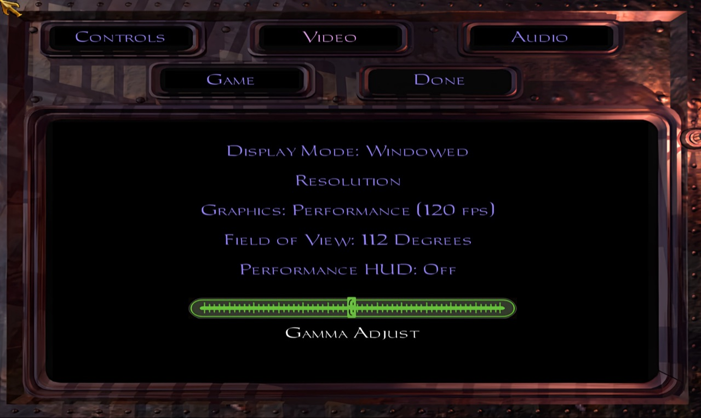

*The Video options page: one Graphics choice, field of view, HUD size and brightness. That's it.*

## Performance

Measured on a MacBook Pro with an M5 Pro, in Lord Bafford's Manor, drawing 3456×2066 pixels (almost the screen's full Retina resolution):

| Setting | Target | Result |
|---|---|---|
| **Performance** | 120 fps | Typical 120 fps in real play |
| **Quality** | 60 fps, every effect including ray tracing | About 11 ms of graphics work per frame, inside the 16.7 ms a 60 fps frame allows |
| **Battery** | 60 fps, light | About 7–9 ms per frame, for long sessions unplugged |

## How far it has got

- All 17 campaign missions load and play. Saving and loading, sound, cutscenes and controls work.
- Lord Bafford's Manor has been completed from start to finish, on Normal and Hard.
- Still to do: long play sessions across every mission, and an independent check.

## For publishers and rights holders

Thief Gold runs on the Mac today: every mission, every cutscene, at up to 120 fps. It's built on the Dark Engine source, which belongs to the game's rights holders, so it's waiting for their go-ahead before anyone else can play it.

If you hold the rights to Thief, let's talk about an official Mac release: [open an issue](https://github.com/gkaragioul/mac-ports/issues) in this repository.

To play Thief Gold today, buy it on [GOG](https://www.gog.com/game/thief_gold) or [Steam](https://store.steampowered.com/app/211600/Thief_Gold/).

*Thief and the Dark Engine are trademarks or property of their respective owners. Unofficial research project, not affiliated with or endorsed by any game publisher. No game data, code or app is distributed here. Pictures and video show the game running on a Mac.*
