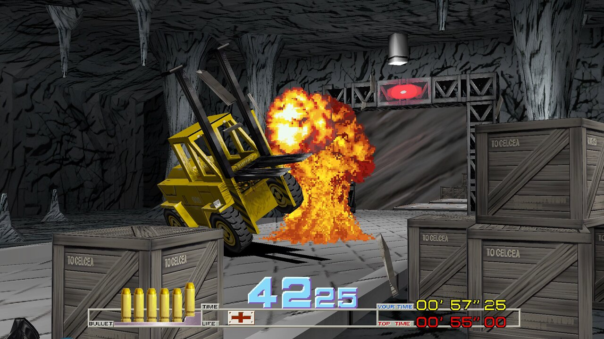
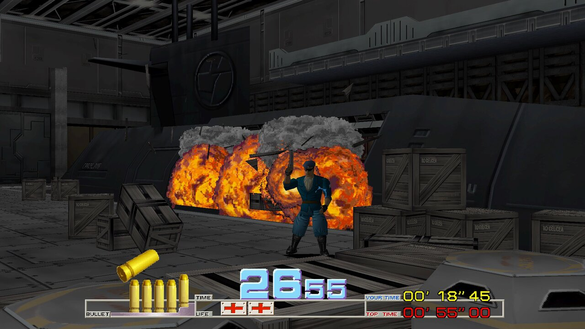

[← All games](../README.md)

# Time Crisis for Mac

Namco's 1995 light-gun arcade game, as a native app for Macs with Apple silicon.

| | |
|---|---|
| **Download** | [⬇️ Time-Crisis-for-Mac-1.0.dmg](https://github.com/gkaragioul/namco22-decompile/releases/download/mac-1.0/Time-Crisis-for-Mac-1.0.dmg) (9.8 MB, version 1.0) |
| **Runs on** | Macs with Apple silicon (M1 or newer), macOS 13 Ventura or newer |
| **You need** | Your own copy of the game: the MAME ROM set `timecris.zip` |
| **Status** | ✅ Playable |

## What's new on the Mac

- Native Apple silicon app, drawn with Metal. Nothing is emulated.
- Up to 120 frames per second, with smooth motion
- Widescreen, sharp at your screen's full resolution
- Mouse controls: the mouse is the gun, the right button is the pedal
- Free play: no coins
- Save and load your game, in 8 slots
- A menu for display, sound and controls (press Esc)

## Install in 5 steps

1. **Download** the file above.
2. **Open** it, and **drag Time Crisis onto the Applications folder**.
3. **Double-click Time Crisis** in Applications. macOS says it was **"Not Opened"**. This is normal for apps that aren't sold through Apple. Click **Done**.
4. **Allow it once:** open the **Apple menu › System Settings › Privacy & Security** and scroll down to **Security**. Next to "Time Crisis was blocked", click **Open Anyway**, then **Open Anyway** again, and enter your Mac password or use Touch ID.
5. **Choose your ROM set:** the game asks for its data. Click **Choose File...** and pick your `timecris.zip`. If your Mac asks whether the game may use files in your Downloads folder, click **Allow**.

From then on, just double-click the game.

## How to play

| | Mouse | Keyboard |
|---|---|---|
| Aim | move the mouse | arrow keys |
| Shoot | left click | Space |
| Come out of cover / take cover | **hold** right click to come out and shoot; **let go** to hide and reload | hold Z |
| Start a game | right click | Z |
| Menu | Esc | Esc |
| Pause | | P |
| Fullscreen on / off | | F11 |

Game controllers work too. You can change the controls in **Esc › Controls**.

## If something goes wrong

- **"The file you chose is not the right one":** open the game again, and choose the right `timecris.zip`.
- **To report a problem:** attach the file `~/Library/Logs/Time Crisis/last-run.log`. In Finder, choose **Go › Go to Folder...** and paste `~/Library/Logs`.
- **Your saves and settings** are in `~/Library/Application Support/Time Crisis`, so replacing the app keeps them.

## Credits and source

- Based on [namco22-decompile](https://github.com/spacestate1/namco22-decompile), the open-source project that translated the arcade code.
- The Mac port is offered back to that project: [spacestate1/namco22-decompile#99](https://github.com/spacestate1/namco22-decompile/pull/99).
- Source of this release: [gkaragioul/namco22-decompile, branch `mac-release-1.0`](https://github.com/gkaragioul/namco22-decompile/tree/mac-release-1.0).
- Tested on an Apple M5 Pro with macOS 27.

*Time Crisis is a trademark of Bandai Namco Entertainment. Unofficial fan project; no game data is included.*
